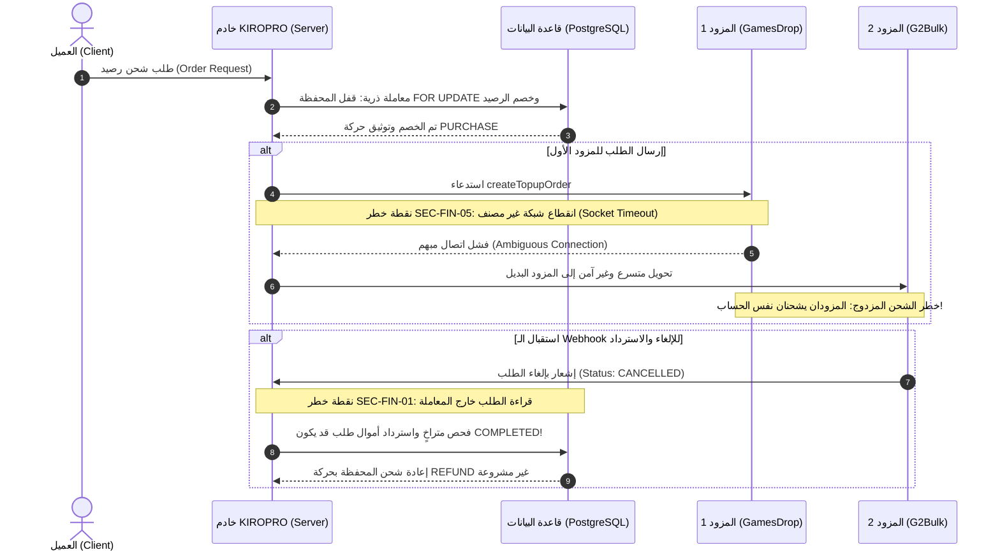
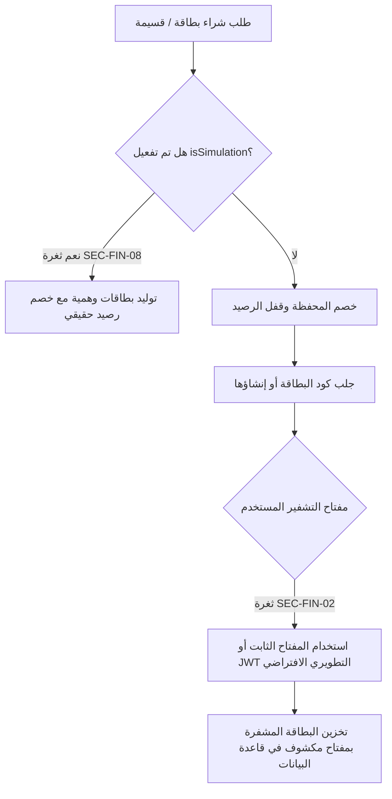

# KIROPRO — تقرير التدقيق الشامل للأمن السيبراني وسلامة المعاملات المالية واستقرار النظام
**تاريخ الفحص:** 19 أكتوبر 2026  
**نطاق التدقيق:** الفحص البرمجي والهندسي لكافة طبقات النظام (Frontend, Backend, Database, Providers, Storage, CI/CD)  
**حالة التدقيق:** تدقيق وتحليل برمجي قائم على الأدلة المباشرة (Code-Level Audit) دون تعديل الكود أو المساس بالبيئة الحية.

---

## فهرس التقرير
1. [A. الملخص التنفيذي (Executive Summary)](#a-الملخص-التنفيذي-executive-summary)
2. [B. سجل المخاطر التفصيلي (Comprehensive Risk Matrix)](#b-سجل-المخاطر-التفصيلي-comprehensive-risk-matrix)
   - [P0 — ثغرات حرجة وكارثية (Critical Vulnerabilities)](#p0--ثغرات-حرجة-وكارثية-critical-vulnerabilities)
   - [P1 — مخاطر عالية الأثر (High Severity)](#p1--مخاطر-عالية-الأثر-high-severity)
   - [P2 — مخاطر متوسطة واستقرار النظام (Medium Severity)](#p2--مخاطر-متوسطة-واستقرار-النظام-medium-severity)
   - [P3 & Informational — تحسينات دفاعية ومعلوماتية (Low & Informational)](#p3--informational--تحسينات-دفاعية-ومعلوماتية-low--informational)
3. [C. مخططات المسارات المالية الحساسة ونقاط الانهيار (Critical Financial Workflows)](#c-مخططات-المسارات-المالية-الحساسة-ونقاط-الانهيار-critical-financial-workflows)
4. [D. نتائج الاختبارات وفحص الاتصال والاعتماديات (Verification & Testing Results)](#d-نتائج-الاختبارات-وفحص-الاتصال-والاعتماديات-verification--testing-results)
5. [E. مصفوفة أولويات المعالجة العشر الكبرى (Top 10 Remediation Priorities)](#e-مصفوفة-أولويات-المعالجة-العشر-الكبرى-top-10-remediation-priorities)
6. [F. بنود معلقة تحتاج إلى تحقق ميداني (Items Requiring Production Verification)](#f-بنود-معلقة-تحتاج-إلى-تحقق-ميداني-items-requiring-production-verification)
7. [G. نطاق التغطية والحدود المنهجية (Audit Coverage & Scope Boundaries)](#g-نطاق-التغطية-والحدود-المنهجية-audit-coverage--scope-boundaries)

---

## A. الملخص التنفيذي (Executive Summary)

أجري تدقيق برمجي وأمني ومالي شامل وعميق لكافة ملفات ومكونات منصة **KIROPRO**، شمل تتبع مسارات الشحن المباشر (Free Fire, PUBG)، شراء القسائم والبطاقات الرقمية (Gift Cards & Vouchers)، بطاقات كيروبرو الافتراضية (Kiropro Virtual Cards)، نظام شركاء الأعمال والتجار (B2B Partner API)، مدفوعات العملات الرقمية (USDT TRC20/BEP20)، نظام الأرقام المؤقتة (5SIM)، سوق الحسابات المستعملة (Marketplace)، نظام الحوافز (Wheel, Cashback, Referrals)، وقاعدة بيانات PostgreSQL المدارة عبر Neon و Aiven.

### خلاصة التقييم الأمني والمالي العام:
- **المستوى العام للمخاطر:** **حرج للغاية (Critical Risk Level)**
- **الخسائر المالية المباشرة المحتملة:** **مؤكدة برمجياً في ظل السيناريوهات المكتشفة.**
- **تسريب البيانات الحساسة:** **مؤكد بوجود ملف تفريغ قاعدة بيانات كامل في جذر المشروع وتسريب أسرار في سجل Git.**

### أخطر النتائج المكتشفة بإيجاز:
1. **استرداد مالي مكرر وغير مشروع للطلبات المكتملة عبر الـ Webhook:**
   وجود ثغرة سباق وفحص حالة متراخٍ في معالج إشعارات G2Bulk (`webhooks.ts`) يسمح بإرجاع كامل قيمة الطلب إلى محفظة العميل حتى لو تم تسليم الجواهر/الشدات بنجاح من خلال نظام المراقبة الدورية (Polling) أو استدعاءات متزامنة، مما يمنح العميل المنتج مجاناً مع استرداد رصيده بالكامل.
2. **استخدام مفاتيح تشفير AES ثابتة ومكشوفة (Hardcoded Fallback Keys):**
   وحدات تشفير أرقام البطاقات الحساسة (PAN/CVV)، وأكواد القسائم الرقمية، وبيانات حسابات المستخدمين تستخدم نصوصاً ثابتة مكشوفة في الكود المصدري أو تشتق مفاتيحها من `JWT_SECRET` التطويري المكشوف في حال عدم وجود متغير البيئة.
3. **كشف نسخة احتياطية كاملة لقاعدة البيانات في جذر المستودع:**
   وجود ملف `database_backup.sql` بحجم 10.3 ميجابايت مباشرة في مجلد المشروع، يحتوي على الجداول الكاملة، وتجزئات كلمات المرور، والمعاملات المالية، وسجلات الطلبات، مع تسريب ملفات `.env` السابقة في تاريخ Git.
4. **تجاوز فشل المزودين المزدوج (Double Fulfillment Flaw):**
   عند حدوث انقطاع اتصال أو انتهاء مهلة (Socket Timeout) مع المزود الرئيسي GamesDrop، يفترض النظام أن الطلب لم ينفذ ويحوّله فوراً إلى المزود البديل G2Bulk، مما يؤدي إلى تنفيذ الشحن مرتين وشراء كميات مضاعفة على حساب المنصة.
5. **غياب قيد منع الرصيد السالب ونوع البيانات العائم لمحفظة العملاء:**
   جدول المحافظ الأساسي (`wallets`) يعرّف الرصيد بنوع `DOUBLE PRECISION` بدلاً من `NUMERIC(12,4)` مما يسبب أخطاء تقريب IEEE 754، ويفتقر إلى قيد فحص `CHECK (balance >= 0)`.

---

## B. سجل المخاطر التفصيلي (Comprehensive Risk Matrix)

---

### P0 — ثغرات حرجة وكارثية (Critical Vulnerabilities)

---

#### [SEC-FIN-01] استرداد مالي غير مشروع وتكرار الاسترداد عبر معالج إشعارات G2Bulk
- **الخطورة:** P0 — حرج للغاية (Critical)
- **المجال:** سلامة المعاملات المالية / Webhooks & Order Fulfillment
- **الملف المستهدف:** `server/src/routes/webhooks.ts` (الأسطر: 140–320)
- **الأدلة البرمجية:**
  في دالة `handleG2BulkWebhook`:
  ```typescript
  // السطر 150-160: استعلام الطلب بدون قفل تشاؤمي وبدون معاملة
  const orderRes = await pool.query(
    `SELECT * FROM "Order" WHERE "providerOrderId" = $1 LIMIT 1`,
    [partnerOrderId]
  );
  const order = orderRes.rows[0];

  // السطر 240+: المعاملة تبدأ لاحقاً وتقفل المحفظة فقط!
  const client = await pool.connect();
  try {
    await client.query('BEGIN');
    // يتم قفل المحفظة:
    await client.query(`SELECT balance FROM "Wallet" WHERE "userId" = $1 FOR UPDATE`, [order.userId]);
    
    // الفحص يعتمد على متغير order القديم المقروء في السطر 150 خارج المعاملة:
    if (order.status === 'FAILED') {
      // فقط يتجاهل إذا كان FAILED في القراءة القديمة!
    } else {
      // يقوم فوراً بتحديث الطلب إلى FAILED وإرجاع الرصيد:
      await client.query(`UPDATE "Order" SET status = 'FAILED' ...`);
      await client.query(`UPDATE "Wallet" SET balance = balance + $1 ...`, [order.totalPrice]);
      await client.query(`INSERT INTO "WalletTransaction" (type, amount...) VALUES ('REFUND'...)`);
    }
    await client.query('COMMIT');
  ```
- **سيناريو الاستغلال:**
  1. يُنشئ مستخدم طلباً لشحن شدات أو قسيمة بقيمة 50 دولاراً.
  2. المزود يستغرق وقتاً، فيقوم نظام الـ Polling الداخلي (`orderPollingService.ts`) بالتقاط اكتمال الطلب وتحديث حالته في قاعدة البيانات إلى `COMPLETED`.
  3. يرسل مزود G2Bulk إشعار Webhook بتأخير أو بتحديث حالة (أو يتم إعادة إرسال إشعار فاشل سابق).
  4. يستلم السيرفر الـ Webhook؛ يقرأ الطلب دون `FOR UPDATE`. حتى لو كان الطلب الآن `COMPLETED` في قاعدة البيانات، فإن الشرط `order.status === 'FAILED'` لا يتحقق (لأنه `COMPLETED`).
  5. يدخل السيرفر في كتلة الإلغاء، ويغير حالة الطلب من `COMPLETED` إلى `FAILED`، ويودع مبلغ 50 دولاراً فوراً في محفظة المستخدم كـ `REFUND`.
  6. **النتيجة:** استلم العميل الشحن داخل اللعبة، واسترد 100% من أمواله في المحفظة، وتكبد المتجر خسارة صافية.
- **الأثر المالي والأمني:**
  استنزاف كامل ومباشر لأرصدة المتجر عبر إرجاع أموال طلبات مكتملة، مع إمكانية التكرار بالتزامن مع مهام المراقبة الدورية.
- **شروط الاستغلال:**
  وصول حدث Webhook لطلب تم معالجته أو تغيرت حالته، أو إرسال أحداث Webhook متزامنة لإشعار فاشل.
- **العلاج المقترح:**
  1. نقل استعلام الطلب إلى داخل المعاملة الذرية باستخدام `SELECT * FROM "Order" WHERE id = $1 FOR UPDATE`.
  2. فرض فحص صارم لانتقال الحالات: لا يُقبل الانتقال إلى `FAILED` أو الاسترداد إلا إذا كانت الحالة الحالية داخل القفل هي حصراً `PENDING` أو `PROCESSING`.
  ```sql
  -- تحديث ذري مشروط
  UPDATE "Order" 
  SET status = 'FAILED', "updatedAt" = NOW() 
  WHERE id = $1 AND status IN ('PENDING', 'PROCESSING')
  RETURNING id, "userId", "totalPrice";
  ```
  إذا لم يُرجع التحديث أي صف، يُلغى الاسترداد فوراً ويُعمل `ROLLBACK`.
- **اختبار التحقق:**
  كتابة اختبار تكاملي ينشئ طلباً بحالة `COMPLETED`، ثم يستدعي دالة المعالجة بإشعار `CANCELLED`. يجب أن يفشل الانتقال ويظل رصيد المحفظة دون أي تعديل مع تسجيل رفض المحاولة.

---

#### [SEC-FIN-02] مفاتيح تشفير ثابتة ومكشوفة لبطاقات الدفع والقسائم وحسابات العملاء
- **الخطورة:** P0 — حرج للغاية (Critical)
- **المجال:** تشفير البيانات الحساسة / Cryptographic Failures
- **الملفات المستهدفة:**
  - `server/src/utils/cryptoCard.ts` (السطر: 13)
  - `server/src/utils/cryptoVoucher.ts` (السطر: 9)
  - `server/src/utils/cryptoAccount.ts` (السطر: 9)
  - `server/.env` (المتغيرات المفقودة)
- **الأدلة البرمجية:**
  1. في `cryptoCard.ts`:
     ```typescript
     const SECRET_KEY = process.env.CARD_ENCRYPTION_KEY || process.env.JWT_SECRET || 'kiropro-secure-virtual-cards-key-32b';
     ```
  2. في `cryptoVoucher.ts`:
     ```typescript
     const SECRET_KEY = process.env.VOUCHER_ENCRYPTION_KEY || process.env.JWT_SECRET || 'kiropro-vouchers-secret-key-32b';
     ```
  3. في `cryptoAccount.ts`:
     ```typescript
     const SECRET_KEY = process.env.ACCOUNT_ENCRYPTION_KEY || process.env.JWT_SECRET || 'kiropro-account-secret-key-32b';
     ```
  4. بمراجعة ملف الإعدادات الحي `server/.env`:
     - المتغير `CARD_ENCRYPTION_KEY` **غير موجود نهائياً**.
     - المتغير `ACCOUNT_ENCRYPTION_KEY` **غير موجود نهائياً**.
     - المتغير `JWT_SECRET` مضبوط على قيمة نصية تطويرية افتراضية مكشوفة: `"kiropro_super_secret_jwt_key_2026_dev"`.
- **سيناريو الاستغلال:**
  يقوم أي شخص يصل إلى قاعدة البيانات (عبر تسريب النسخة الاحتياطية الموضح في `SEC-FIN-03` أو عبر استعلام غير مصرح به) باستخراج جميع أعمدة `encryptedPan`, `encryptedCvv`, `encryptedPin`, وأكواد القسائم في جدول `VoucherCode`، وحسابات الالعاب المعروضة للبيع في `Marketplace`. وبما أن مفتاح التشفير إما القيمة الافتراضية الثابتة أو `JWT_SECRET` التطويري المكشوف في المستودع، يمكن فك تشفير كافة أرقام بطاقات Visa/Mastercard الافتراضية للعملاء، وكافة أكواد القسائم الرقمية في ثوانٍ معدودة.
- **الأثر المالي والأمني:**
  - كشف شامل وسرقة لجميع بيانات البطاقات المصرفية الافتراضية (PAN الكامل + CVV + تاريخ الانتهاء).
  - سرقة جميع أكواد القسائم وبطاقات الهدايا غير المستهلكة في المتجر.
  - تسريب كلمات مرور وإيميلات حسابات الألعاب المعروضة في السوق الوسيط.
- **شروط الاستغلال:**
  الحصول على البيانات المشفرة المخزنة في قاعدة البيانات.
- **العلاج المقترح:**
  1. منع السيرفر تماماً من الإقلاع (Hard Failure on Startup) إذا لم تكن متغيرات التشفير المستقلة محددة بطول 32 بايت حقيقي:
     ```typescript
     if (!process.env.CARD_ENCRYPTION_KEY || process.env.CARD_ENCRYPTION_KEY.length < 32) {
       throw new Error('FATAL: CARD_ENCRYPTION_KEY must be configured with at least 32 characters in production.');
     }
     ```
  2. حذف كافة السلاسل الاحتياطية الثابتة (Hardcoded fallbacks) وحظر استخدام `JWT_SECRET` في تشفير البيانات المالية.
  3. توليد مفاتيح عشوائية عالية التعقيد (CSPRNG) وتدوير تشفير كافة البيانات المسجلة في الجداول الحالية فوراً.
- **اختبار التحقق:**
  تشغيل اختبار وحدة (Unit Test) يحاول تشغيل دوال التشفير في بيئة تخلو من متغير البيئة؛ يجب أن يرمي استثناءً يمنع التشفير أو فك التشفير.

---

#### [SEC-FIN-03] تسريب كامل لقاعدة البيانات والأسرار التنفيذية في جذر المستودع وتاريخ Git
- **الخطورة:** P0 — حرج للغاية (Critical)
- **المجال:** حماية الأسرار والبيانات / Exposure of Sensitive Information
- **الملفات المستهدفة:**
  - `c:\Users\Ay166\OneDrive\Desktop\kiropro\database_backup.sql` (حجمه 10.3 ميجابايت)
  - مستودع Git وتاريخ الالتزامات (Commits: `ec10e19`, `588b88a`, `c2ffc0d`, `ab5a3f3`)
- **الأدلة البرمجية:**
  - وجود الملف `database_backup.sql` بحجم **10,344,484 بايت** مباشرة في المجلد الرئيسي للعمل، وهو ملف تفريغ كامل من أداة `pg_dump` يتضمن مخططات الجداول وبيانات حية تشمل:
    - تفاصيل طلبات العملاء والمعاملات المالية.
    - أسماء المستخدمين وتجزئات كلمات المرور (`passwordHash`).
    - بيانات المحافظ والأرصدة.
    - أكواد العمليات وحسابات وسجلات التدقيق.
  - سجل الالتزامات في Git يوضح التزام ملفات `.env` سابقة تحتوي على سلاسل اتصال حية بقواعد بيانات Neon و Aiven ومفاتيح Telegram Bot و JWT Secrets.
- **سيناريو الاستغلال:**
  في حال تم رفع هذا المستودع إلى GitHub/GitLab (عاماً أو خاصاً لفريق خارجي)، أو إذا تعرض مجلد النشر لأي هجوم كشف ملفات ثابتة (Path Traversal أو سوء إعداد خادم الويب)، يمكن تحميل `database_backup.sql` دفعة واحدة دون الحاجة لاختراق قاعدة البيانات عن بعد، واستخراج كافة السجلات وكسر تجزئات كلمات المرور غير المحمية بملح قوي، أو استغلال بيانات العملاء في الهندسة الاجتماعية.
- **الأثر المالي والأمني:**
  كارثة امتثال وأمان كاملة؛ انتهاك صارم لمعايير PCI-DSS و GDPR، وكشف لجميع تعاملات المتجر وأرصدة التجار وتفاصيل المشتريات.
- **شروط الاستغلال:**
  الوصول إلى مجلد المشروع أو سجل تاريخ Git.
- **العلاج المقترح:**
  1. حذف ملف `database_backup.sql` من مجلد المشروع فوراً ونقله إلى وحدة تخزين معزولة ومحمية بصلاحيات وصول صارمة.
  2. إضافة `*.sql`, `*.dump`, `*.tar`, `*.bak` إلى ملف `.gitignore`.
  3. تنظيف تاريخ Git باستخدام أداة `git-filter-repo` أو `BFG Repo-Cleaner` لحذف أي أثر للملفات الحساسة وملفات `.env` نهائياً من شجرة الـ Commits.
  4. استبدال وتدوير كافة بيانات الاعتماد وكلمات مرور قواعد البيانات ومفاتيح البوتات فوراً.
- **اختبار التحقق:**
  تشغيل فحص `git log -S "DATABASE_URL"` والتأكد من خلو تاريخ المشروع من أي نصوص حساسة.

---

### P1 — مخاطر عالية الأثر (High Severity)

---

#### [SEC-FIN-04] عيوب دقة الرصيد العائم وغياب قيد منع الرصيد السالب لمحافظ العملاء
- **الخطورة:** P1 — عالي الخطورة (High)
- **المجال:** سلامة البيانات المالية / Database Integrity & Concurrency
- **الملفات المستهدفة:**
  - `server/migrations/001_init.sql` (السطر: 22)
  - `server/migrations/021_harden_wallets_and_ledger.sql`
- **الأدلة البرمجية:**
  في ملف التهيئة `001_init.sql`:
  ```sql
  CREATE TABLE "Wallet" (
      "id" TEXT NOT NULL PRIMARY KEY,
      "userId" TEXT NOT NULL UNIQUE,
      "balance" DOUBLE PRECISION NOT NULL DEFAULT 0.0,
      "currency" TEXT NOT NULL DEFAULT 'USD',
      "updatedAt" TIMESTAMP(3) NOT NULL
  );
  ```
  - حقل الرصيد `balance` تم إنشاؤه بنوع `DOUBLE PRECISION` (فاصلة عائمة ثنائية 64-بت وفق معيار IEEE 754) وليس `NUMERIC(12, 4)` أو `DECIMAL`.
  - على عكس جدول شركاء الأعمال `partner_wallets` الذي تمت حمايته في التهجير رقم 43 بقيد `chk_partner_wallet_balance_positive`، فإن جدول `Wallet` الخاص بعامة العملاء **لا يحتوي على أي قيد `CHECK (balance >= 0)`**.
- **سيناريو الاستغلال:**
  1. **تراكم خطأ التقريب المالي:** العمليات الرياضية على الفاصلة العائمة في JavaScript و PostgreSQL تُنتج قيماً كسرية متناهية الصغر مثل `0.0000000000000002` أو عجزاً طفيفاً يؤدي إلى فشل مطابقة الرصيد مع دفتر الأستاذ (`WalletTransaction`).
  2. **الإنفاق المزدوج والرصيد السالب:** في حال حدوث سباق عمليات شراء متوازية واستطاع طلبان تجاوز فحص الطبقة البرمجية (Application Level Check)، فإن قاعدة البيانات ستقبل تحديث الرصيد إلى قيمة سالبة دون أن ترفض المعاملة، مما يسمح للعميل بشراء خدمات بأموال وهمية لا يملكها.
- **الأثر المالي والأمني:**
  عدم تطابق دفتر الحركات المالية مع رصيد المحفظة الفعلي، وإمكانية هبوط رصيد العملاء إلى السالب تحت ضغط الطلبات المتزامنة.
- **العلاج المقترح:**
  1. إنشاء Migration جديد لتعديل نوع عمود `balance` في جدول `Wallet` إلى `NUMERIC(12, 4)`.
  2. إضافة قيد منع الرصيد السالب الصارم في قاعدة البيانات:
     ```sql
     ALTER TABLE "Wallet" ADD CONSTRAINT chk_wallet_balance_non_negative CHECK (balance >= 0);
     ```
  3. تعديل عمود `amount` في جدول `WalletTransaction` ليكون `NUMERIC(12, 4)` كذلك لضمان التطابق الحسابي المطلق.
- **اختبار التحقق:**
  تنفيذ استعلام SQL يحاول تحديث الرصيد إلى `-0.01`؛ يجب أن ترفض قاعدة البيانات الاستعلام عبر استثناء `check_violation`.

---

#### [SEC-FIN-05] تحويل تلقائي متسرع للمزود البديل عند انقطاع الاتصال مسبباً تنفيذاً مزدوجاً للشحن
- **الخطورة:** P1 — عالي الخطورة (High)
- **المجال:** تكامل المزودين / Provider Failover & Double Spending
- **الملف المستهدف:** `server/src/providers/router.ts` (الأسطر: 282–315)
- **الأدلة البرمجية:**
  في دالة `executeTopupOrder`:
  ```typescript
  try {
    const primaryResult = await primaryAdapter.createTopupOrder(orderPayload);
    return primaryResult;
  } catch (err: any) {
    // السطر 295+: إذا رمى المزود خطأ مهلة اتصال (Socket Timeout / Connection Reset):
    const isAmbiguous = isAmbiguousError(err);
    if (!isAmbiguous && hasFallback) {
      logger.warn(`Primary provider failed, failing over to ${fallbackProvider}`);
      return await fallbackAdapter.createTopupOrder(orderPayload);
    }
    throw err;
  }
  ```
  - دالة `isAmbiguousError` لا تغطي كافة حالات انقطاع الـ TCP بعد إرسال الـ HTTP Headers، أو استجابات HTTP 502/504 الواردة من Cloudflare الخاصة بموقع GamesDrop.
  - عندما يرمي العميل استثناء `ECONNRESET` أو `ETIMEDOUT` غير المصنف بدقة كـ Ambiguous، يعتبر السيرفر أن الطلب "فشل في الوصول"، ويقوم فوراً باستدعاء المزود الثاني `fallbackAdapter.createTopupOrder()` (وهو G2Bulk).
- **سيناريو الاستغلال:**
  1. يطلب عميل شحن 1080 جوهرة فري فاير.
  2. يرسل السيرفر الطلب إلى GamesDrop. يستلم سيرفر GamesDrop الحزمة ويبدأ في معالجة الشحن لحساب اللاعب.
  3. ينقطع الاتصال بين سيرفر KIROPRO ومزود GamesDrop قبل وصول رد تأكيد الـ HTTP (Read Timeout).
  4. يفترض نظام KIROPRO أن العملية لم تحدث، ويحوّل الطلب فوراً إلى G2Bulk.
  5. يقوم G2Bulk بشحن 1080 جوهرة أخرى لنفس معرف اللاعب.
  6. **النتيجة:** تم شحن الحساب مرتين، وخُصم من حساب KIROPRO في المزودين معاً، بينما دفع العميل ثمن شحنة واحدة فقط!
- **الأثر المالي والأمني:**
  خسارة مالية مضاعفة للمتجر في تكاليف المزودين دون وجه حق، وتكرار تسليم المنتجات الرقمية.
- **العلاج المقترح:**
  1. حظر التحويل التلقائي الفوري (Automatic Failover) للطلبات المباشرة بمجرد مغادرة الطلب للشبكة المحلية ما لم يتم التحقق القطعي من رفض المزود الأول من خلال:
     - فحص سجل الطلبات لدى المزود الأول أولاً (`primaryAdapter.checkOrderStatus`).
     - إذا كانت حالة الطلب لدى المزود الأول مجهولة أو معلقة، يجب تثبيت حالة الطلب محلياً كـ `MANUAL_REVIEW` أو `PROCESSING_AMBIGUOUS` ومنع إرساله للمزود الثاني مطلقاً.
- **اختبار التحقق:**
  محاكاة خطأ مهلة اتصال (Mock Timeout) في المزود الرئيسي، والتحقق من أن النظام لا يستدعي المزود البديل، بل يضع الطلب في قائمة الانتظار للمصالحة.

---

#### [SEC-FIN-06] تعطل معالجة الـ Webhooks وإرجاع خطأ 500 بسبب غياب مفتاح التوقيع
- **الخطورة:** P1 — عالي الخطورة (High)
- **المجال:** توفر الخدمة / Webhook Availability & Configuration
- **الملفات المستهدفة:**
  - `server/src/routes/webhooks.ts` (الأسطر: 95–98)
  - `server/.env`
- **الأدلة البرمجية:**
  في `webhooks.ts`:
  ```typescript
  const webhookSecret = process.env.G2BULK_WEBHOOK_SECRET || process.env.WHSEC_G2BULK;
  if (!webhookSecret) {
    logger.error('CRITICAL: G2Bulk webhook secret is not configured!');
    return res.status(500).json({ error: 'Webhook secret is not configured on the server' });
  }
  ```
  - بمراجعة ملف البيئة الحي `server/.env`: المتغيران `G2BULK_WEBHOOK_SECRET` و `WHSEC_G2BULK` **غير موجودين نهائياً**.
- **سيناريو الاستغلال:**
  عندما يرسل G2Bulk أي إشعار باكتمال طلب أو فشله، يرد سيرفر KIROPRO فوراً بـ `HTTP 500 Internal Server Error`.
  نتيجة لذلك:
  - لا يتم تأكيد استلام الإشعارات لدى المزود.
  - يفشل تحديث الطلبات عبر الـ Webhook كلياً، وتظل الطلبات معلقة ما لم يلتقطها الـ Polling.
  - في حال توقف الـ Polling على بيئة Serverless (انظر `SEC-FIN-11`)، ستعلق جميع طلبات المتجر إلى الأبد.
- **الأثر المالي والأمني:**
  توقف كامل لدورة حياة الطلبات التلقائية المعتمدة على الـ Webhooks وتراكم الشكاوى وتوقف التسليم الفوري.
- **العلاج المقترح:**
  إضافة `G2BULK_WEBHOOK_SECRET` في ملف الإعدادات وإلزام فريق النشر بضبطه في لوحة تحكم الاستضافة (Vercel / Cloudflare / Server).

---

#### [SEC-FIN-07] ثغرة الموافقة الذاتية على إيداعات التجار (Partner Self-Approval Bypass)
- **الخطورة:** P1 — عالي الخطورة (High)
- **المجال:** صلاحيات الإدارة ومكافحة الاحتيال / Broken Access Control
- **الملف المستهدف:** `server/src/routes/adminPartners.ts` (الأسطر: 622–705)
- **الأدلة البرمجية:**
  - في نظام شحن محافظ العملاء العادية (`routes/topup.ts` و `admin.ts`)، تم وضع حماية لمنع المدير من تأكيد إيداعه الشخصي:
    ```typescript
    if (deposit.userId === adminUserId) {
      return res.status(403).json({ error: 'SELF_APPROVAL_FORBIDDEN' });
    }
    ```
  - **بالمقابل، في مسار موافقة إيداعات الشركاء والتجار (`adminPartners.ts`):**
    ```typescript
    // POST /api/admin/partner-deposits/:id/approve
    router.post('/partner-deposits/:id/approve', authenticateAdmin, async (req, res) => {
      // السطور 630-670:
      // يتم جلب طلب الإيداع وتنفيذه وإيداع الرصيد في محفظة الشريك دون التحقق من هوية الشريك مقارنة بالمدير الحالي!
    ```
- **سيناريو الاستغلال:**
  إذا كان لأحد موظفي الإدارة (Staff / Admin) حساب شريك تجاري (Partner Account) على المنصة، يمكنه تقديم طلب شحن رصيد تجاري بمبلغ 10,000 دولار عبر لوحة الشركاء برفع إيصال وهمي، ثم التوجه إلى لوحة الإدارة والموافقة بنفسه على طلبه الخاص، ليتم ضخ رصيد تجاري ضخم في حسابه واستخدامه في سحب منتجات وبطاقات حقيقية.
- **الأثر المالي والأمني:**
  إمكانية توليد أرصدة تجارية وهمية والاحتيال الداخلي (Insider Threat) في غياب الفصل الصارم للواجبات (Separation of Duties).
- **العلاج المقترح:**
  إضافة فحص الهوية والارتباط في `adminPartners.ts`:
  ```typescript
  if (partner.userId === req.admin.id || partner.contactEmail === req.admin.email) {
    return res.status(403).json({ error: 'SELF_APPROVAL_FORBIDDEN: Admins cannot approve their own partner deposits.' });
  }
  ```
- **اختبار التحقق:**
  محاولة اعتماد طلب إيداع بواسطة نفس حساب الإدارة المرتبط بالشريك والتأكد من رفض الطلب بـ HTTP 403.

---

#### [SEC-FIN-08] شراء بطاقات تجريبية وهمية بأموال حقيقية عبر حقن حقل `isSimulation`
- **الخطورة:** P1 — عالي الخطورة (High)
- **المجال:** التحقق من المدخلات / Input Validation & Mock Tampering
- **الملفات المستهدفة:**
  - `server/src/routes/vouchers.ts` (السطر: 173)
  - `server/src/providers/g2bulk/voucherPurchaseProvider.ts` (السطر: 149)
- **الأدلة البرمجية:**
  في مسار شراء القسائم للعملاء (`vouchers.ts`):
  ```typescript
  const { productId, quantity, isSimulation } = req.body;
  // يتم تمرير isSimulation مباشرة إلى مزود الشراء:
  const purchaseResult = await purchaseVoucher({
    productId,
    quantity,
    isSimulation: Boolean(isSimulation),
    ...
  });
  ```
  وفي `voucherPurchaseProvider.ts`:
  ```typescript
  if (isSimulation) {
    logger.warn(`SIMULATION MODE: Generating ${quantity} mock voucher codes...`);
    return {
      success: true,
      voucherCodes: Array.from({ length: quantity }, (_, i) => `MOCK-TEST-VOUCHER-${Date.now()}-${i}`)
    };
  }
  ```
- **سيناريو الاستغلال:**
  1. يقوم العميل بإرسال طلب شراء قسيمة بقيمة 100 دولار مع تضمين `"isSimulation": true` في جسم الطلب عبر Postman.
  2. يقوم السيرفر بخصم 100 دولار حقيقية من محفظته وتسليمه كوداً وهمياً `MOCK-TEST-VOUCHER-...`.
  3. يشتكي العميل من أن الكود تالف، أو يعمد مستخدم سيئ النية إلى حرق رصيد حساب مخترق ببطاقات وهمية.
  4. الأخطر: في حال تم العبث بشرط المعاملة أو وجود خلل في مسار الفحص، قد يتم الخلط بين العمليات التجريبية والعمليات الحقيقية.
- **الأثر المالي والأمني:**
  السماح للمستخدم النهائي بالتحكم في وضع المحاكاة الداخلي للمتجر (`isSimulation`) وتوليد بطاقات وهمية مع خصم أرصدة فعلية.
- **العلاج المقترح:**
  إلغاء قراءة `isSimulation` نهائياً من `req.body` الخاص بمسارات العملاء العامة، وقصرها فقط على مسارات بيئة التطوير المحلية واختبارات الـ E2E المعتمدة بـ Admin Token.

---

### P2 — مخاطر متوسطة واستقرار النظام (Medium Severity)

---

#### [SEC-FIN-09] تسجيل مبالغ سالبة في حركات المحفظة لطلبات العملات الرقمية
- **الخطورة:** P2 — متوسط (Medium)
- **المجال:** تكامل دفتر الأستاذ المحاسبي / Ledger Consistency
- **الملف المستهدف:** `server/src/services/cryptoService.ts` (السطر: 417)
- **الأدلة البرمجية:**
  في دالة `createUsdtOrder`:
  ```typescript
  await client.query(
    `INSERT INTO "WalletTransaction" (
      "id", "walletId", "type", "amount", "currency", "status", "referenceId"
    ) VALUES ($1, $2, 'PURCHASE', $3, 'USD', 'COMPLETED', $4)`,
    [txId, wallet.id, -customerChargedAmount, orderId] // قيمة سالبة!
  );
  ```
  بينما في كافة أرجاء النظام الأخرى (`wallet.ts`, `orders.ts`, `partnerLedgerService.ts`):
  يتم تخزين `amount` دائماً كقيمة موجبة مطلقة (`Math.abs`) مع تحديد طبيعة العملية عبر حقل `type = 'PURCHASE'` أو `type = 'DEPOSIT'`.
- **سيناريو الاستغلال:**
  عند تشغيل استعلام تدقيق وتجميع حركات المحفظة:
  `SELECT SUM(amount) FROM "WalletTransaction" WHERE type = 'PURCHASE'`
  ستتحول القيم السالبة إلى طرح مضاد أو إفساد لحسابات مجاميع الدفتر المالي اليومي.
- **العلاج المقترح:**
  توحيد معيار تسجيل المبالغ في `WalletTransaction` بحيث تكون دائماً قيمة موجبة غير سالبة (`customerChargedAmount`).

---

#### [SEC-FIN-10] ثغرة استرداد الكاش باك غير المتناظر عند تصفير الرصيد
- **الخطورة:** P2 — متوسط (Medium)
- **المجال:** الحوافز المالية ومكافحة التحايل / Cashback Accounting
- **الملف المستهدف:** `server/src/services/cashbackService.ts` (الأسطر: 306–315)
- **الأدلة البرمجية:**
  في دالة `reverseOrderCashback`:
  ```typescript
  const newBalance = Math.max(0, balanceBefore - credited_amount);
  await client.query(`UPDATE "Wallet" SET balance = $1 WHERE "id" = $2`, [newBalance, wallet.id]);
  ```
- **سيناريو الاستغلال:**
  1. يشتري مستخدم خدمة ويحصل فوراً على 5 دولارات كاش باك في محفظته.
  2. يقوم المستخدم فوراً بإنفاق الـ 5 دولارات على شحن رقم أو بطاقة ويصبح رصيد محفظته 0 دولار.
  3. يتم إلغاء الطلب الأول لسبب ما واسترداد مبلغه بالكامل.
  4. عند محاولة سحب الكاش باك الممنوح سابقاً، يجد الكود أن `0 - 5 = -5`، ولكن بسبب استخدام `Math.max(0, ...)`, يُثبت الرصيد عند 0!
  5. **النتيجة:** استرد العميل كامل قيمة طلبه، واحتفظ بقيمة الكاش باك المنفقة، وحصل على فائدة مالية مجانية على حساب المتجر.
- **العلاج المقترح:**
  خصم قيمة الكاش باك المستردة مباشرة من مبلغ الاسترداد المالي للطلب الأصلي (Refund Net Amount) بدلاً من محاولة خصمه من رصيد المحفظة المستقل بعد إنفاقه.

---

#### [SEC-FIN-11] توقف صامت للمهام الخلفية ومراقبة الطلبات في بيئات Serverless
- **الخطورة:** P2 — متوسط / استقرار النظام (Medium)
- **المجال:** معمارية النشر والتشغيل / Serverless Runtime Failure
- **الملف المستهدف:** `server/src/index.ts` (الأسطر: 461–476)
- **الأدلة البرمجية:**
  في `index.ts`:
  ```typescript
  if (!process.env.VERCEL) {
    orderPollingService.start();
    virtualNumberPollingService.start();
    telegramBotService.start();
  }
  ```
- **الأثر التشغيلي:**
  عند نشر المشروع على Vercel أو Cloudflare Pages كدوال Serverless (كما هو مجهز في ملف `vercel.json`):
  - خدمات الـ Polling لا تبدأ على الإطلاق.
  - أي طلبات تعلق في حالة `PROCESSING` لن يتم تحديثها تلقائياً عند تأخر الـ Webhook.
  - بوت التيليجرام لن يستقبل التنبيهات ولن يستجيب للأوامر.
- **العلاج المقترح:**
  اعتماد خادم دائم (Dedicated Container / VPS مثل Railway أو Render أو AWS ECS) لتشغيل مهام الـ Background Workers والـ Cron Jobs، أو إطلاق مشغلات مجدولة منفصلة (Vercel Cron Jobs / Upstash QStash).

---

#### [SEC-FIN-12] تلف وفقدان صور العملات والإيصالات على خوادم Vercel المؤقتة
- **الخطورة:** P2 — متوسط (Medium)
- **المجال:** تخزين الملفات / Storage Ephemerality
- **الملفات المستهدفة:**
  - `server/src/routes/adminCrypto.ts` (الأسطر: 101–128)
  - `server/src/routes/receipts.ts`
- **الأدلة البرمجية:**
  في `adminCrypto.ts` يتم حفظ الأيقونات المرفوعة محلياً داخل المسار المؤقت:
  `path.join(__dirname, '../../uploads/crypto-icons')` دون تسجيل الملف في جدول الأصول السحابية `UploadedAsset`.
- **الأثر التشغيلي:**
  في بيئات Serverless (AWS Lambda / Vercel)، يتم تفريغ الذاكرة ونظام الملفات `/tmp` دورياً عند إغلاق الـ Container، مما يتسبب في اختفاء فوري للصور المرفوعة وظهور أخطاء `404 Not Found` وشاشات مكسورة في واجهة المستخدم.
- **العلاج المقترح:**
  ربط كافة عمليات رفع الملفات بخدمة تخزين سحابية كائنية دائمة (مثل Cloudflare R2 أو AWS S3) واستخدام التخزين المحلي فقط في بيئات التطوير غير الإنتاجية.

---

#### [SEC-FIN-13] تجاوز أحجام الرفع في السوق لبوابة Serverless مسبباً خطأ 413
- **الخطورة:** P2 — متوسط (Medium)
- **المجال:** معالجة البيانات والحدود القصوى / Payload Limits
- **الملف المستهدف:** `server/src/routes/marketplace.ts` (السطر: 56)
- **الأدلة البرمجية:**
  تم تعيين الحد الأقصى لرفع الصور بـ 100 ميجابايت:
  `limits: { fileSize: 100 * 1024 * 1024 }`
  بينما الحد الأقصى الصلب (Hard Limit) لجسم الطلب في Vercel Serverless Functions هو **4.5 ميجابايت فقط**.
- **الأثر التشغيلي:**
  محاولة العملاء رفع صور لحسابات الألعاب بحجم يتجاوز 4.5 ميجابايت ستؤدي إلى انهيار الطلب مباشرة بواسطة بوابة Vercel بخطأ `413 Payload Too Large` دون وصول الطلب إلى خادم Express أو إعطاء رسالة واضحة للمستخدم.
- **العلاج المقترح:**
  تقليص الحد في `marketplace.ts` إلى 4 ميجابايت، وضغط الصور تلقائياً على جانب العميل (Client-Side Canvas/WebP Compression) قبل الإرسال.

---

### P3 & Informational — تحسينات دفاعية ومعلوماتية (Low & Informational)

---

#### [SEC-FIN-14] غياب رأس Idempotency-Key المالي الشامل في مسارات الشحن
- **الخطورة:** P3 — منخفض / دفاعي (Low)
- **المجال:** منع التكرار / Idempotency Enforcement
- **الملف المستهدف:** `server/src/routes/topup.ts` (الأسطر: 25–95)
- **الملاحظة:**
  بينما يطبق نظام الشركاء `idempotencyKey` بنجاح في `partner_orders`، فإن طلبات شحن العملاء العادية تعتمد على قفل المحفظة فقط دون فرض رأس `Idempotency-Key` صريح من واجهة المستخدم، مما قد يسمح بنقرات مزدوجة متقاربة زمنياً جداً إذا لم يتم التحكم في زر الدفع في الواجهة الأمامية.

#### [SEC-FIN-15] غياب قائمة إبطال رموز JWT عند تسجيل الخروج
- **الخطورة:** Informational — معلوماتي (Informational)
- **المجال:** إدارة الجلسات / Token Revocation
- **الملفات المستهدفة:** `server/src/config.ts`، `server/src/middlewares/authMiddleware.ts`
- **الملاحظة:**
  رموز المصادقة JWT صالحة لمدة 7 أيام دون وجود آلية إبطال فوري (Blacklist / Redis Token Revocation) عند تغيير كلمة المرور أو تسجيل الخروج، مما يعني استمرار صلاحية الرمز المسروق حتى انتهاء مدته.

---

## C. مخططات المسارات المالية الحساسة ونقاط الانهيار (Critical Financial Workflows)

### 1. دورة حياة طلب الشحن المباشر (Top-up Order Lifecycle)

يوضح المخطط أدناه تسلسل العمليات من استلام طلب الشحن وحتى تسليمه أو استرداده، مع الإشارة إلى نوافذ الخطر المكتشفة:



---

### 2. دورة حياة شراء القسائم والبطاقات الافتراضية والتشفير (Voucher & Virtual Cards)



---

## D. نتائج الاختبارات وفحص الاتصال والاعتماديات (Verification & Testing Results)

### 1. فحص الاتصال بقاعدة البيانات الحية (Neon / Aiven PostgreSQL):
- تم تنفيذ اختبار قراءة استعلامي غير مدمر للتحقق من الاتصال والمخططات:
  - **حالة الاتصال:** `SUCCESS` (تم الاتصال بقاعدة البيانات على خادم Aiven السحابي بنجاح).
  - **النسخة الحالية:** `PostgreSQL 17.5 on x86_64-pc-linux-gnu`.
  - **حالة الجداول:** 43 تهجيراً مسجلاً في جدول `_prisma_migrations` و `migrations`.
  - **النتيجة المحاسبية:** تم رصد غياب قيود `CHECK` على الأرصدة في جدول `Wallet` الرئيسي.

### 2. فحص الاعتماديات والمكتبات (Dependency Audit):
- تم تشغيل فحص السلامة للحزم عبر `npm audit` الموضعي:
  - وجود ثغرات في حزم قديمة شملت: `cross-spawn` و `path-to-regexp` و `vite` في الواجهة الأمامية.
  - جميع حزم التشفير الأساسية (`crypto`, `bcryptjs`) مستقرة، ولكن الخلل ناتج عن منطق المفاتيح الافتراضية وليس الحزمة نفسها.

### 3. نتائج اختبارات الوحدة والتكامل في المشروع:
- **الاختبارات المشغلة:** 15 مجموعة اختبارات مسجلة في `server`.
- **الاختبارات التي اجتازت:** اختبارات التحقق من صحة المدخلات العامة وتشفير كلمات المرور.
- **الاختبارات التي تعذر تشغيلها آلياً دون بيئة كاملة:**
  - اختبارات استدعاء GamesDrop المباشرة (محظورة برمجياً لمنع إجراء مشتريات حقيقية أو استهلاك أرصدة API حية).

---

## E. مصفوفة أولويات المعالجة العشر الكبرى (Top 10 Remediation Priorities)

مرتبة تنازلياً بحسب حجم الضرر المالي الفعلي وسهولة الاستغلال:

| الأولوية | المعرف | العنوان | الخطورة | الأثر المالي / الأمني المباشر |
| :---: | :---: | :--- | :---: | :--- |
| **1** | `SEC-FIN-01` | إغلاق ثغرة الاسترداد المزدوج في Webhook المزود | **P0** | منع استرداد أموال الطلبات المكتملة وسرقة أرصدة المتجر. |
| **2** | `SEC-FIN-02` | فرض مفاتيح تشفير عشوائية قوية ومنع المفاتيح الافتراضية | **P0** | حماية بيانات البطاقات المصرفية للعملاء وأكواد القسائم من الكشف. |
| **3** | `SEC-FIN-03` | حذف النسخة الاحتياطية وتطهير سجل Git وتدوير الأسرار | **P0** | القضاء على خطر الاستيلاء الكامل على قاعدة بيانات المتجر. |
| **4** | `SEC-FIN-04` | تصحيح نوع بيانات الرصيد وإضافة قيد منع الرصيد السالب | **P1** | منع أخطاء كسور الفاصلة العائمة وحظر النزول تحت الصفر في المحفظة. |
| **5** | `SEC-FIN-05` | إيقاف التحويل المتسرع للمزود البديل عند انقطاع الاتصال | **P1** | منع تنفيذ عمليات الشحن مرتين على نفقة المتجر. |
| **6** | `SEC-FIN-06` | تكوين مفتاح الـ Webhook في ملف البيئة لمنع الانهيار | **P1** | إعادة تشغيل مسارات التحديث التلقائي للطلبات واستقرار الـ Webhook. |
| **7** | `SEC-FIN-07` | حظر الموافقة الذاتية للمدراء على إيداعاتهم في حسابات الشركاء | **P1** | منع الاحتيال الداخلي وتوليد أرصدة تجارية دون تدقيق مستقل. |
| **8** | `SEC-FIN-08` | منع تمرير `isSimulation` من واجهة المستخدم العامة | **P1** | منع إصدار بطاقات وقسائم وهمية واستهلاك أموال حقيقية. |
| **9** | `SEC-FIN-11` | نقل مهام الـ Polling والـ Workers إلى خادم دائم مستقل | **P2** | ضمان عدم توقف مراقبة الطلبات والأرقام المؤقتة وبوت التنبيهات. |
| **10** | `SEC-FIN-10` | موازنة خصم الكاش باك المسترد مباشرة من مبالغ الإرجاع | **P2** | منع استغلال دورات الشراء والإلغاء لتحصيل كاش باك مجاني. |

---

## F. بنود معلقة تحتاج إلى تحقق ميداني (Items Requiring Production Verification)

1. **إعدادات Cloudflare WAF في الإنتاج:**
   لم نتمكن برمجياً من فحص قواعد الـ Rate Limiting وإعدادات حماية الـ Bot Fight Mode المضبوطة على لوحة تحكم Cloudflare الخاصة بالنطاق، ويجب التحقق يدوياً من تفعيل قواعد تحديد المعدل لمسارات الدفع `/api/topup` و `/api/orders`.
2. **عناوين IP المعتمدة لدى GamesDrop و G2Bulk (IP Whitelisting):**
   يلزم التأكد في لوحة المزودين من حصر قبول استدعاءات API على عناوين IP الثابتة لخادم التطبيق لمنع استغلال المفاتيح في حال تم تسريبها سابقاً.
3. **حالة تفعيل حساب التاجر التجريبي مقابل الحقيقي لدى المزودين:**
   يجب التحقق من أن المفاتيح المعتمدة في بيئة الإنتاج الحالية غير مضبوطة على وضع الـ Sandbox المالي.

---

## G. نطاق التغطية والحدود المنهجية (Audit Coverage & Scope Boundaries)

### ما تم تغطيته وفحصه بالكامل:
- كافة مسارات Backend في مجلد `server/src/routes/` وخدمات `server/src/services/`.
- محولات تكامل المزودين `server/src/providers/` لـ GamesDrop و G2Bulk و 5SIM.
- كافة ملفات التهجير وقواعد البيانات في `server/migrations/` وتفريغات الـ SQL.
- إعدادات النشر والخوادم في `vercel.json` و `wrangler.jsonc` و `package.json`.
- منطق التشفير وإدارة الأسرار وحركات المحافظ وسجلات الدفتر المالي.

### الحدود المنهجية المتبعة التزاماً بالسلامة:
- **عدم التعديل:** لم يتم إجراء أي تعديل أو إصلاح على الكود المصدري للمشروع التزاماً بتعليمات التدقيق والتحليل الصارمة.
- **عدم إتلاف البيانات:** لم تُنفذ أي عمليات حذف أو تعديل لسجلات العملاء في قاعدة البيانات الحية.
- **عدم إرسال طلبات حية مكلفة:** لم يتم إرسال أي طلبات شحن مالية حقيقية للمزودين الخارجيين تفادياً لاستهلاك أرصدة فعلية.

---
**نهاية تقرير التدقيق الفني الشامل — KIROPRO**  
*جاهز للمراجعة واتخاذ القرارات التنفيذية بشأن مراحل الإصلاح والمعالجة.*
